# Worked example: one nucleus through the pipeline

This page runs the complete analysis (`drivers/` steps 01–05) on the five cells in `test_data/`
and shows every output, following one nucleus, **k27_k27_thaw009** (NT), from the raw export to the
condition statistics. For what each calculation does, see the interactive chart in
[`../pipeline_flow.html`](../pipeline_flow.html); for the settings, `drivers/config.py`.

All numbers, tables and figures below come from that run; the files shown are copied into
[`figures/`](figures) and [`outputs/`](outputs). Five cells are far too few for real
conclusions, so read step 05 as a demonstration of the outputs, not a result.

## The run

| | |
|---|---|
| Data | `test_data/`: 5 cells, 2 NT and 3 ActD (condition from the cell name) |
| Settings | the defaults in `drivers/config.py` (full calibration, not `--quick`) |
| Calibration | `per_condition`: one calibration per condition, each on its densest cell |
| Run time | 14 min in total: step 01 7 s, step 02 13.8 min, step 03 7 s, step 04 2 s, step 05 1 s |

| cell_id | condition | role |
|---|---|---|
| k27_k27_act10_thaw002 | ActD |  |
| k27_k27_act10_thaw003 | ActD |  |
| k27_k27_act10_thaw016 | ActD | ActD calibration source |
| k27_k27_thaw009 | NT | **example cell, NT calibration source** |
| k27_k27_thaw010 | NT |  |

To repeat it, open `full_pipeline.ipynb` and set `DATA_DIR = REPO_ROOT / "test_data"`, or set
`DATA_DIR` in `drivers/config.py` and run `python drivers/run_all.py`. This run also called
`np.random.seed(0)` first: the simulated nucleus in step 02 draws from NumPy's global random
state, so without the seed a rerun gives slightly different calibration numbers.

## Step 01: preprocess

Each mark is axially filtered, both marks are pooled to build the nucleus mask, and the mask
is cut into 100 radial bands. Mask threshold for this cell: **1.43**
(0.5 × Otsu of the smoothed density); mask area **242 µm²**;
me3:ac localization ratio **1.16**.

|  | H3K27me3 | H3K27ac |
|---|---|---|
| localizations in the export | 334,552 | 281,965 |
| kept (axial filter + mask) | 259,436 (78%) | 224,295 (80%) |
| density (localizations / µm²) | 1070 | 925 |

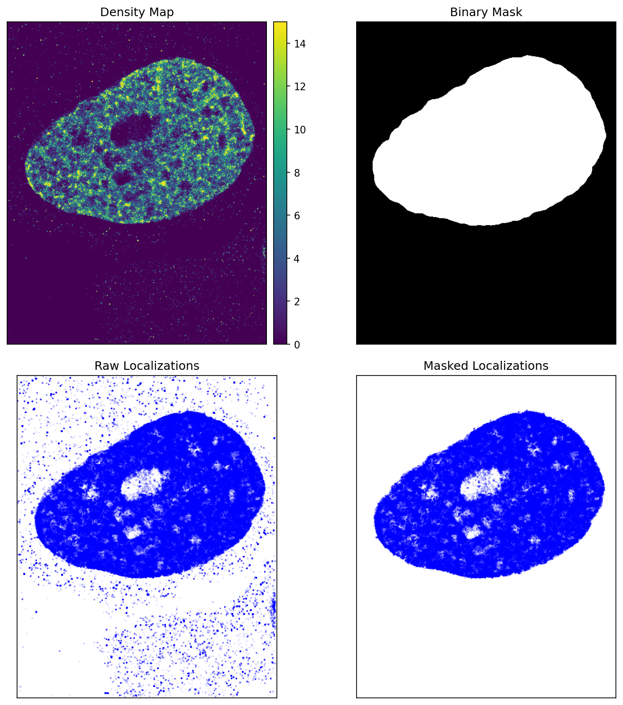

*`qc_mask.png`: the smoothed density map, the binary mask, and the localizations before and
after masking. Check that the mask covers the whole nucleus and nothing else.*

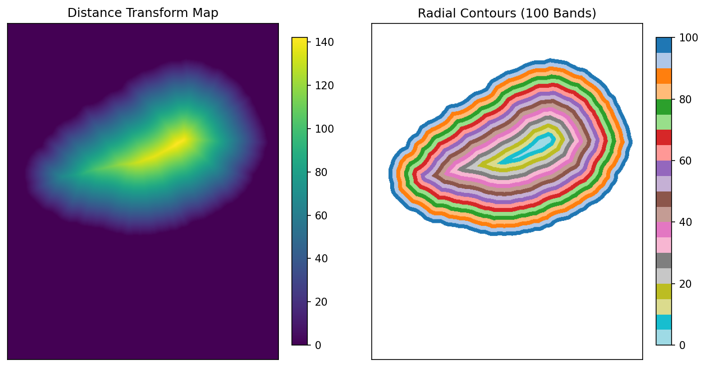

*`qc_contours.png`: distance to the nuclear edge and the 100 bands (0 = core, 99 = rim).*

Saved in `cells/k27_k27_thaw009/`: `me3_masked.parquet`, `ac_masked.parquet`, `mask.npz`,
[`preprocess.json`](outputs/preprocess.json) and the two QC figures.

## Step 02: calibrate DBSCAN

This cell is the densest NT cell, so it is the NT calibration source: everything in this
section was computed on it, separately for each mark. (The ActD calibration ran the same way
on k27_k27_act10_thaw016.)

### 2b: the simulated nucleus

`generate_nucleus` rebuilds each mark as a simulation with known domains, using the cell's
radial profile, RDF, ADF and pair correlation:

| mark | domain scale (nm) | noise fraction | locs per domain | domains | g(r) cross-check | seed placement | Thomas σ (nm) | simulated locs | real locs |
|---|---|---|---|---|---|---|---|---|---|
| H3K27me3 | 200 | 0.00 | 59.3 | 4,373 | 3,470 | thomas | 237 | 253,282 | 259,436 |
| H3K27ac | 250 | 0.00 | 39.3 | 5,709 | 3,444 | thomas | 812 | 210,220 | 224,295 |

The g(r) fit put the noise fraction at 0 for both marks, so these simulations contain no background localizations. The older local-density estimate, kept for comparison, gives 0.51 (me3) and 0.47 (ac).

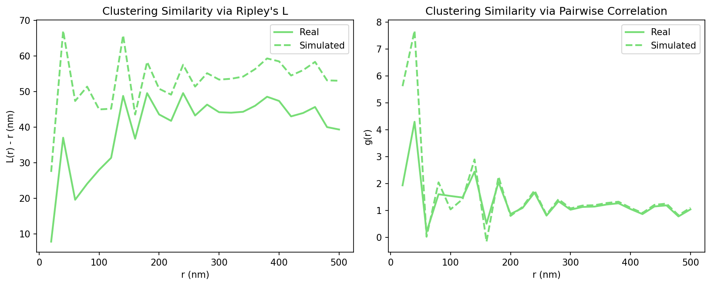
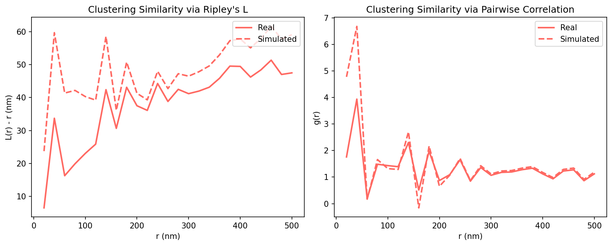

*`<ch>_pair_correlation.png` (me3, then ac): L(r) − r and g(r) of the real cell (solid) and the
simulation with noise (dashed). The closer they lie, the better the simulation matches the cell.*

### 2c–2d: crop and density fractions

| mark | crop (µm) | in-mask area (µm²) | true domains overlapping a neighbour | gt_target (nm) |
|---|---|---|---|---|
| H3K27me3 | 5.0 × 5.0 | 25.0 | 98% | 303 |
| H3K27ac | 5.0 × 5.0 | 23.9 | 99% | 367 |

The crop is then thinned at random to 1.0, 0.9 … 0.1 of its localizations. A high share of
overlapping true domains means DBSCAN cannot separate them at any setting (weak point A1 on
the pipeline page).

### 2e–2f: best parameters and the calibration curves

For every fraction, every min_samples from 5 to 70 is tried with an eps search, keeping the
pair whose mean cluster size best matches `gt_target`. Fractions whose best size error is
under 50 nm enter the fit.

**H3K27me3**

| fraction | density (/µm²) | best eps (nm) | best min_samples | size error (nm) | in fit |
|---|---|---|---|---|---|
| 1.0 | 1045 | 125.2 | 55 | 0.1 | yes |
| 0.9 | 940 | 126.4 | 50 | 0.0 | yes |
| 0.8 | 836 | 132.8 | 60 | 0.1 | yes |
| 0.7 | 731 | 128.5 | 45 | 0.0 | yes |
| 0.6 | 627 | 120.7 | 15 | 0.0 | yes |
| 0.5 | 522 | 147.6 | 50 | 0.3 | yes |
| 0.4 | 418 | 118.2 | 10 | 0.0 | yes |
| 0.3 | 313 | 144.4 | 20 | 0.2 | yes |
| 0.2 | 209 | 156.1 | 25 | 0.7 | yes |
| 0.1 | 104 | 178.1 | 10 | 0.0 | yes |

eps = 44.6 × ρ^-0.146 (R² 0.68); min_samples = 4.932e+04 × ρ + 5.7 (R² 0.62); ρ in localizations per nm².

The best min_samples ranges from 10 to 60 and jumps by up to 40 between neighbouring fractions, while eps changes smoothly: many (eps, min_samples) pairs give nearly the same mean size, so min_samples is only loosely determined (weak point B2).

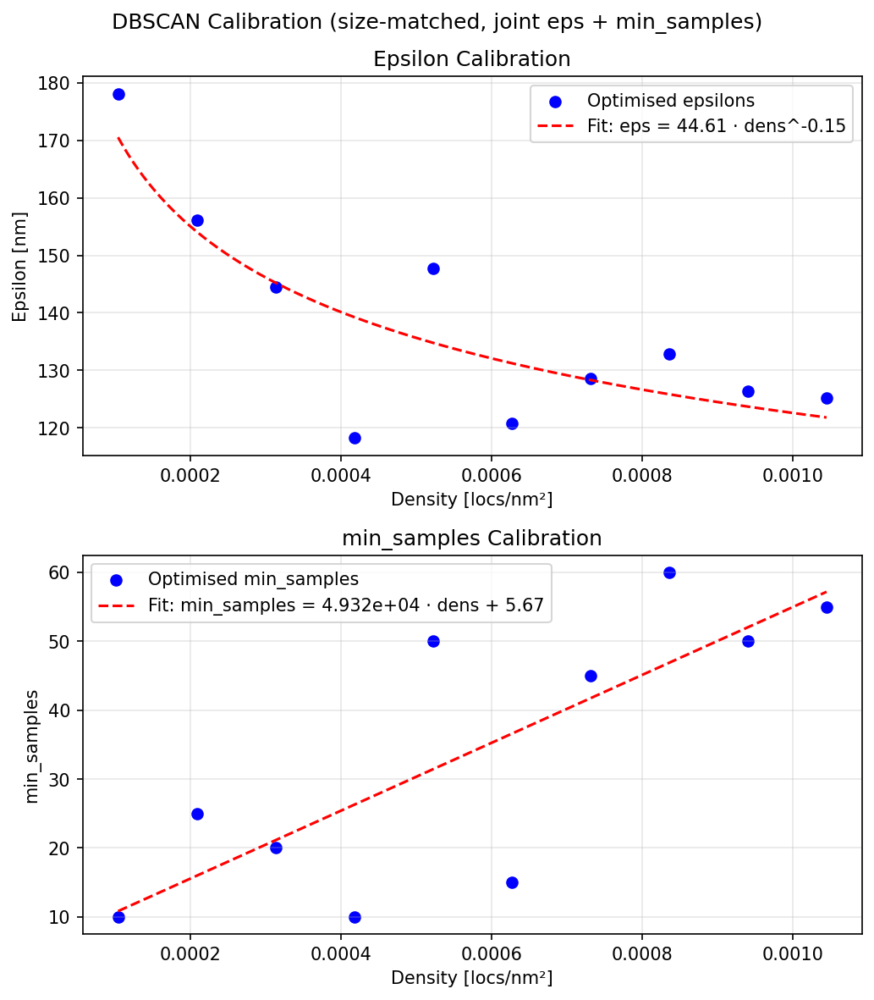

**H3K27ac**

| fraction | density (/µm²) | best eps (nm) | best min_samples | size error (nm) | in fit |
|---|---|---|---|---|---|
| 1.0 | 867 | 141.3 | 50 | 1.0 | yes |
| 0.9 | 780 | 143.0 | 45 | 0.7 | yes |
| 0.8 | 694 | 160.2 | 60 | 0.0 | yes |
| 0.7 | 607 | 159.1 | 50 | 0.0 | yes |
| 0.6 | 520 | 163.7 | 35 | 0.1 | yes |
| 0.5 | 433 | 172.9 | 45 | 0.2 | yes |
| 0.4 | 347 | 163.4 | 30 | 0.3 | yes |
| 0.3 | 260 | 174.9 | 30 | 0.1 | yes |
| 0.2 | 173 | 193.3 | 25 | 0.4 | yes |
| 0.1 | 87 | 172.5 | 5 | 0.2 | yes |

eps = 76.4 × ρ^-0.097 (R² 0.58); min_samples = 5.208e+04 × ρ + 12.7 (R² 0.74); ρ in localizations per nm².

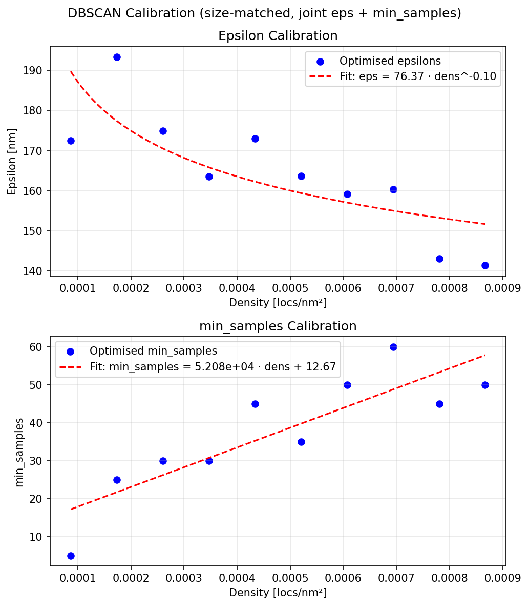

### 2g: does size still depend on density?

Every fraction is clustered with fixed parameters (the curves' values at full density) and
with density-corrected parameters. Corrected sizes should stay flat.

- H3K27me3: R² of mean size against density: fixed 0.81, corrected 0.09 (fixed parameters found no nanodomain at 6 of 10 fractions, so its R² uses the remaining fractions).
- H3K27ac: R² of mean size against density: fixed 0.92, corrected 0.65 (fixed parameters found no nanodomain at 6 of 10 fractions, so its R² uses the remaining fractions).

Fixed parameters keep min_samples at its full-density value, too high for the sparse fractions to form any cluster; for H3K27me3 the fixed min_samples is 57, and the correction removes most of the density dependence; for H3K27ac the fixed min_samples is 58, and the corrected sizes still drift with density.

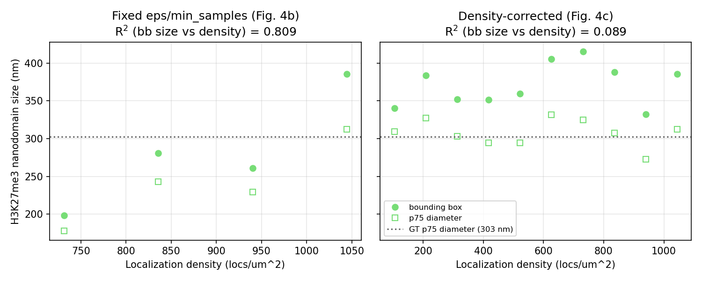
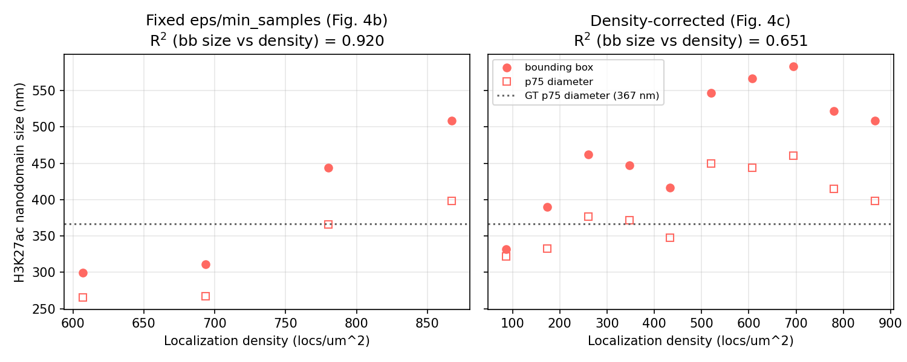

*`<ch>_size_vs_density.png` (me3, then ac): mean nanodomain size against density with fixed
parameters (left; only the fractions where clusters formed) and density-corrected parameters
(right). Filled circles are bounding-box sizes, open squares p75 diameters; the dotted line is
the simulation's true p75 diameter.*

Saved in `calibration/NT/` per mark: [`<ch>_calibration.json`](outputs/NT_me3_calibration.json)
(what step 03 reads), `<ch>_simulated.parquet`, `<ch>_size_vs_density.csv` and the figures above.

## Step 03: cluster

Each mark is clustered with the parameters its calibration curves give at this cell's own
density:

| mark | density (/µm²) | calibrated range (/µm²) | eps (nm) | min_samples | extrapolated | nanodomains | locs clustered | mean / median size (nm) | mean p75 diameter (nm) |
|---|---|---|---|---|---|---|---|---|---|
| H3K27me3 | 1070 | 104–1045 | 121.3 | 58 | no | 148 | 14% | 369 / 333 | 293 |
| H3K27ac | 925 | 87–867 | 150.7 | 61 | yes | 211 | 27% | 492 / 437 | 391 |

H3K27ac is flagged as extrapolated although this cell is its own calibration source: the simulation produced 210,220 localizations against the cell's 224,295, so the cell's density (925 /µm²) is 7% above the densest calibrated fraction (867 /µm²), beyond the 5% tolerance.

The five largest H3K27me3 nanodomains (from [`me3_nanodomains.csv`](outputs/me3_nanodomains.csv);
coordinates and sizes in nm, hull area in nm², density in localizations per nm²):

| label | n_locs | centroid_x | centroid_y | centroid_z | bb_size_2D | geometric_diameter_2D | hull_size_2D | density_2D |
|---|---|---|---|---|---|---|---|---|
| 27 | 1386 | 2571 | 17165 | 550 | 1087 | 912 | 5.17e+05 | 0.00268 |
| 24 | 1380 | 11200 | 26551 | 555 | 890 | 730 | 5.05e+05 | 0.00273 |
| 34 | 1032 | 2334 | 18718 | 546 | 818 | 643 | 4.62e+05 | 0.00223 |
| 8 | 976 | 22468 | 22026 | 567 | 764 | 583 | 3.58e+05 | 0.00273 |
| 7 | 931 | 14986 | 17131 | 602 | 639 | 453 | 3.07e+05 | 0.00303 |

Mean nanodomain sizes here (369 nm for me3, 492 nm for ac) are well above
the manuscript's roughly 120–190 nm. That is the known effect of the simulated domains being too
large and overlapping (weak points A1–A4 on the pipeline page), not a property of this cell.

Saved in `cells/k27_k27_thaw009/`: `<ch>_clustered.parquet`, `<ch>_nanodomains.csv` and
[`cluster.json`](outputs/cluster.json).

## Step 04: radial profiles and SNCR

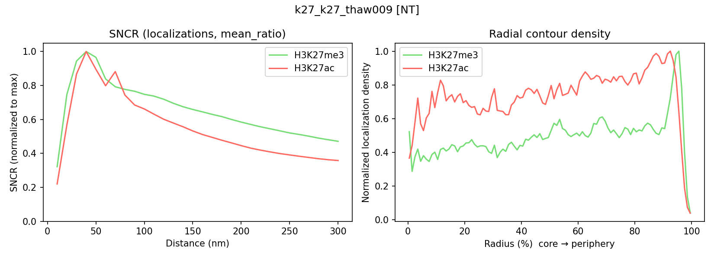

*`spatial.png`: left, the self:nonself contact ratio around each mark's nanodomains (localization
neighbours, per-domain mean, normalized to its maximum); right, each mark's localization
density across the 100 radial bands, core to rim.*

Exponential decay fits to the SNCR curves, r ≤ 200 nm, from each curve's peak outward
([`sncr_fit.csv`](outputs/sncr_fit.csv)); the `localizations` rows are the ones step 05 uses. The H3K27ac nanodomains fit is degenerate (A = C = 0, no R²); it is not used downstream.

| reference mark | neighbors | k (1/nm) | A | C | R² |
|---|---|---|---|---|---|
| H3K27me3 | nanodomains | -0.0049 | 0.13 | 0.000616 | 0.95 |
| H3K27me3 | localizations | -0.0148 | 3.47 | 2.62 | 0.97 |
| H3K27ac | nanodomains | -0.0176 | 0 | 0 | — |
| H3K27ac | localizations | -0.0114 | 3.77 | 1.32 | 0.98 |

Saved in `cells/k27_k27_thaw009/`: `radial_profile.csv`, `sncr.csv`, `sncr_fit.csv`, `spatial.png`.

## Step 05: pool cells and compare conditions

One row per cell ([`per_cell_summary.csv`](outputs/per_cell_summary.csv); the full file has more
columns). Sizes are mean bounding-box sizes in nm; k is the SNCR decay rate in 1/nm.

| cell_id | condition | mask (µm²) | n_me3 | n_ac | me3:ac | me3 domains | me3 size (nm) | me3 SNCR k | ac domains | ac size (nm) | ac SNCR k |
|---|---|---|---|---|---|---|---|---|---|---|---|
| k27_k27_act10_thaw002 | ActD | 250 | 51,008 | 10,574 | 4.82 | 59 | 943 | -0.0654 | 118 | 344 | -0.0580 |
| k27_k27_act10_thaw003 | ActD | 198 | 103,757 | 25,111 | 4.13 | 138 | 686 | -0.0009 | 76 | 426 | -0.0155 |
| k27_k27_act10_thaw016 | ActD | 142 | 116,263 | 42,627 | 2.73 | 150 | 426 | -0.0028 | 24 | 497 | -0.0252 |
| **k27_k27_thaw009** | NT | 242 | 259,436 | 224,295 | 1.16 | 148 | 369 | -0.0148 | 211 | 492 | -0.0114 |
| k27_k27_thaw010 | NT | 209 | 201,304 | 179,253 | 1.12 | 119 | 388 | -0.0039 | 175 | 526 | -0.0170 |

ActD against NT ([`stats.csv`](outputs/stats.csv)). With 2 and 3 cells per group the
Mann–Whitney test cannot go below p = 0.2, and a t-test on so few cells is unreliable even when
its p-value is small; this only shows the format.

| metric | n NT | n ActD | mean NT | mean ActD | Mann–Whitney p | Welch t p |
|---|---|---|---|---|---|---|
| me3_ac_ratio | 2 | 3 | 1.14 | 3.894 | 0.2 | 0.047 |
| me3_mean_bb_size_nm | 2 | 3 | 378.4 | 685.1 | 0.2 | 0.18 |
| me3_n_nanodomains | 2 | 3 | 133.5 | 115.7 | 1 | 0.62 |
| me3_sncr_decay_rate | 2 | 3 | -0.009361 | -0.02305 | 0.8 | 0.59 |
| me3_frac_locs_clustered | 2 | 3 | 0.1458 | 0.6009 | 0.2 | 0.14 |
| ac_mean_bb_size_nm | 2 | 3 | 508.8 | 422.1 | 0.4 | 0.18 |
| ac_n_nanodomains | 2 | 3 | 193 | 72.67 | 0.2 | 0.035 |
| ac_sncr_decay_rate | 2 | 3 | -0.01423 | -0.0329 | 0.4 | 0.28 |
| ac_frac_locs_clustered | 2 | 3 | 0.2804 | 0.2971 | 1 | 0.86 |

1 (cell, mark) pair(s) were clustered outside their calibrated density range (flagged in
`cluster.json` and kept).

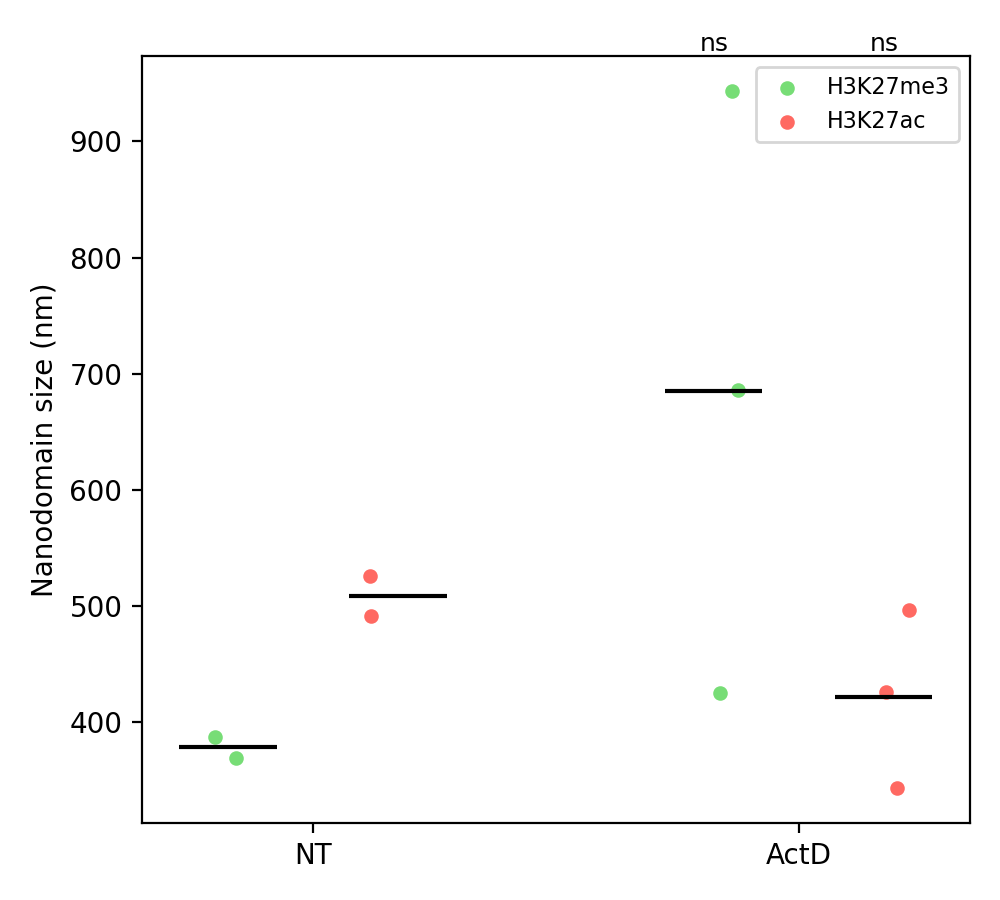
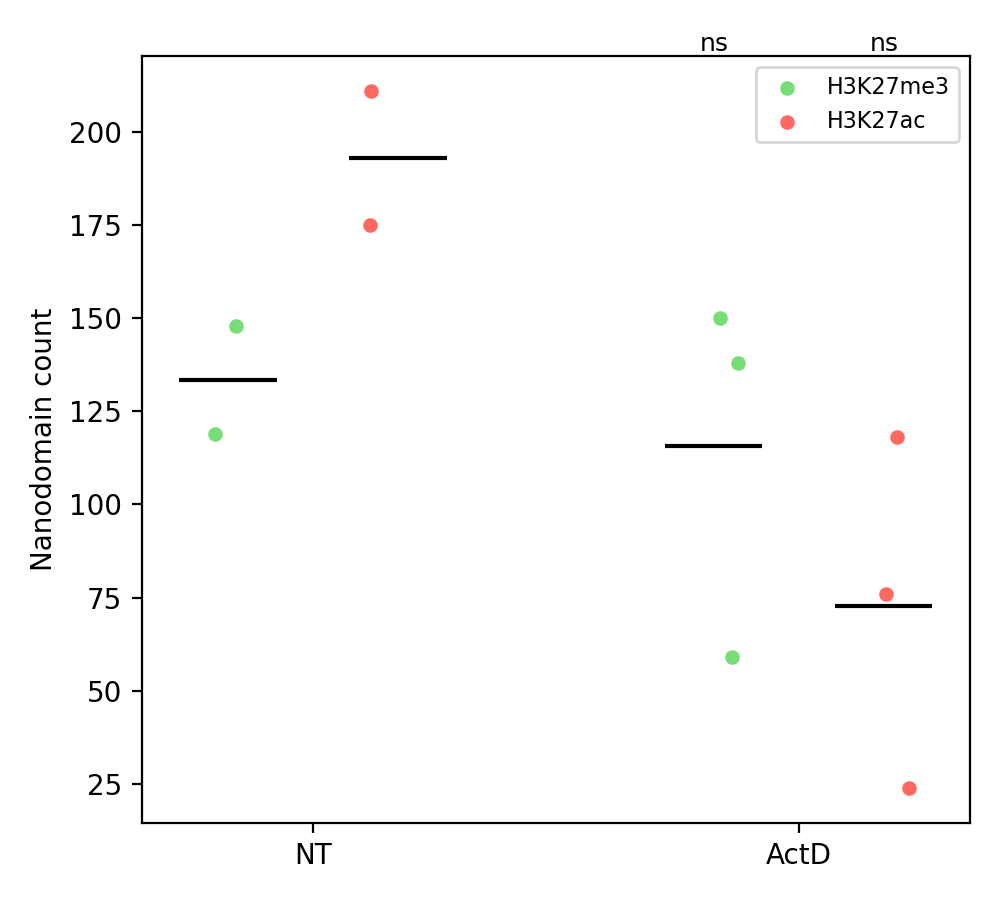

*Fig. 6g/h layout: one dot per nucleus, coloured by mark; black lines are condition means; the
labels above ActD (ns, \*, …) are Mann–Whitney results against NT.*

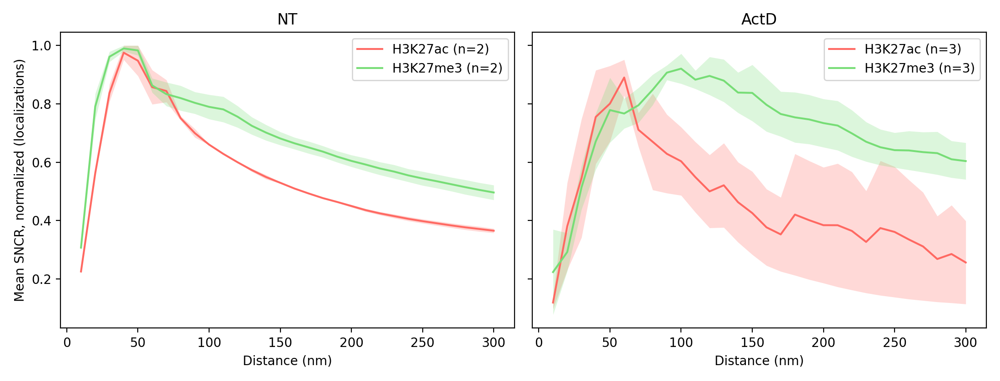

*Fig. 6b/e layout: mean ± SEM of the per-cell SNCR curves, each normalized to its maximum.*

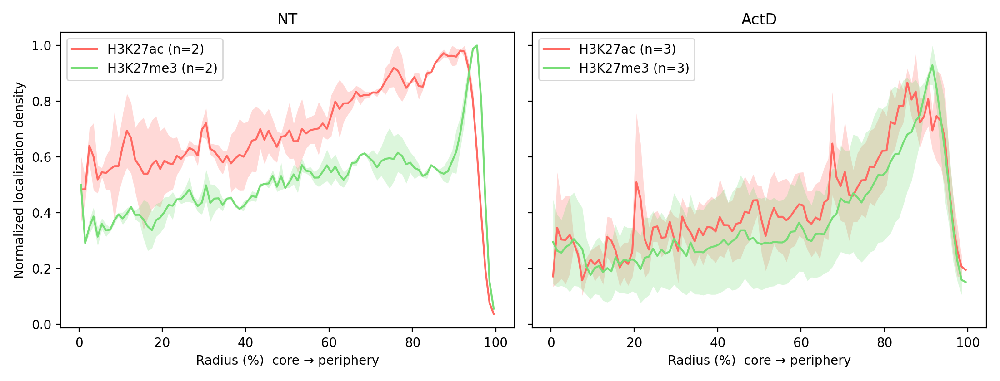

*Fig. 6c/f layout: mean ± SEM of the normalized radial density profiles.*

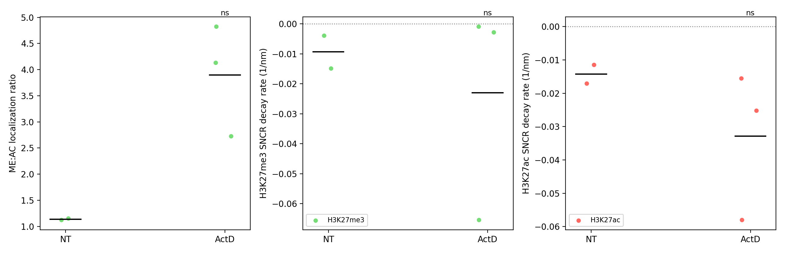

*Fig. S3a–c layout: me3:ac localization ratio and each mark's SNCR decay rate, per nucleus.*

Saved in `results/`: `per_cell_summary.csv`, `nanodomains_all.csv`, `sncr_all.csv`,
`sncr_fits_all.csv`, `radial_profiles_all.csv`, `stats.csv` and the five figures.

## Everything the run wrote

```
analysis_output/
├── manifest.csv
├── cells/<cell_id>/                       one folder per cell
│   ├── me3_masked.parquet, ac_masked.parquet, mask.npz, preprocess.json   step 01
│   ├── qc_mask.png, qc_contours.png                                        step 01
│   ├── me3_clustered.parquet, ac_clustered.parquet                         step 03
│   ├── me3_nanodomains.csv, ac_nanodomains.csv, cluster.json               step 03
│   └── radial_profile.csv, sncr.csv, sncr_fit.csv, spatial.png             step 04
├── calibration/NT/, calibration/ActD/     one folder per calibration      step 02
│   └── <ch>_calibration.json, <ch>_simulated.parquet, <ch>_size_vs_density.csv,
│       <ch>_pair_correlation.png, <ch>_calibration_fit.png, <ch>_size_vs_density.png
└── results/                                                                step 05
    └── per_cell_summary.csv, nanodomains_all.csv, sncr_all.csv, sncr_fits_all.csv,
        radial_profiles_all.csv, stats.csv, fig6g/6h/6_sncr/6_radial/S3 figures
```
